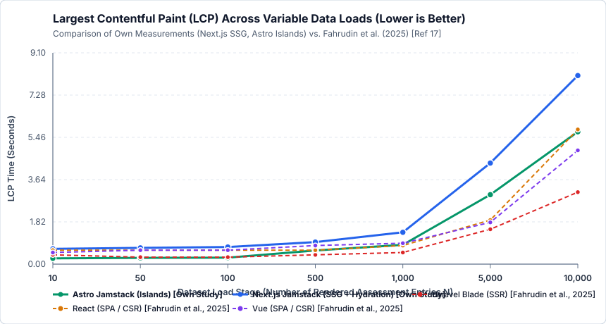
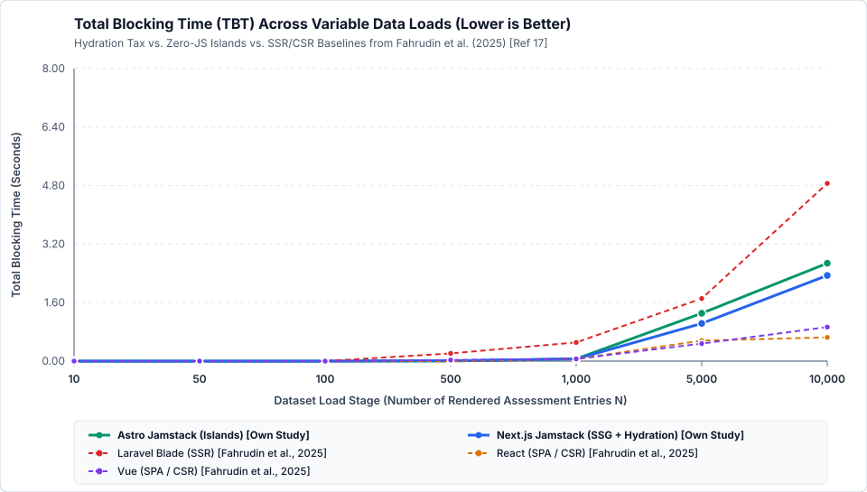

# Research Methods – Web Application Architecture Performance Experiment

**Hochschule Campus Wien** | Master-Lehrveranstaltung: *Research Methods (SS 2026)*  
**Lehrveranstaltungsleitung:** Prof. Slaviša Aleksić, Prof. Aleksandar Pavlović  
**Team B – Gruppe 4:** Fabio Gschweidl, Desirée Iris Hackl, Marco Miklautz, Lorenz Schneider, Danijel Trailovic

---

## 1. Seminar Paper & Reproducibility Quickstart (Empirical Code Submission)

This repository accompanies our seminar paper (**Topic #14**: *Evaluate the impact of web application architecture on performance. Provide technical advice for scalable design of a specific web application architecture.*):

- **Final Seminar Paper (IEEE A4 Template, ≤ 3 pages excl. References):** [`paper/Seminar_Paper_TeamB_Group4.docx`](./paper/Seminar_Paper_TeamB_Group4.docx) (reproducible via `python3 paper/build_paper.py` from [`paper/conference-template-a4.docx`](./paper/conference-template-a4.docx))
- **Refined Research Question:** *"How do modern Jamstack rendering architectures—SSG with full React hydration (Next.js) versus Zero-JS Islands Architecture (Astro)—impact Core Web Vitals (FCP, LCP, TBT, CLS) and Speed Index (SI) under scaling data loads (10 to 10,000 entries) compared to traditional SSR (Laravel Blade) and CSR (React, Vue), and what technical guidelines can be derived for scalable web applications?"*

### Brief Instructions to Run & Reproduce Presented Results
**Prerequisites:** Node.js `≥ 20` (tested on `v24.22.2`), npm, Google Chrome / Chromium (tested on `156.0.8078.79`), and optionally Python `3.10+` (`pillow`) to rebuild the `.docx`.

```bash
# 1. Install root & prototype dependencies (Next.js 15.5.29 / React 19.3.1, Astro 5.18.2, Lighthouse 12.8.2)
npm install
npm --prefix apps/jamstack-nextjs install
npm --prefix apps/jamstack-astro install

# 2. Generate the 7 deterministic datasets (SEED = 20261110, N = 10..10,000) & compile production SSG builds
npm run build

# 3. Execute all 70 automated Google Lighthouse Desktop audits (2 architectures × 7 stages × 5 runs)
npm run benchmark

# 4. Aggregate statistics (mean, SD, median), cross-study tables, and zero-baseline charts
npm run analyze
```

All raw 70-run logs and summary tables used in the paper are pre-saved in [`benchmarks/results/raw-runs.csv`](./benchmarks/results/raw-runs.csv), [`benchmarks/results/raw-runs.json`](./benchmarks/results/raw-runs.json), and [`benchmarks/results/summary-stats.csv`](./benchmarks/results/summary-stats.csv).

---

## 2. Wichtigste Dokumente & Ergebnisse im Repository

| Dokument / Pfad | Beschreibung |
| :--- | :--- |
| **[`paper/Seminar_Paper_TeamB_Group4.docx`](./paper/Seminar_Paper_TeamB_Group4.docx)** | **Finales Seminar Paper** im verbindlichen zweispaltigen IEEE-A4-Template (3 Seiten exkl. References, inkl. Tabellen, Diagramme & Formeln). |
| **[`paper/build_paper.py`](./paper/build_paper.py)** | Reproduzierbares Python-Skript zur Generierung des IEEE-Seminar-Papers direkt aus [`paper/conference-template-a4.docx`](./paper/conference-template-a4.docx). |
| **[`ausarbeitung-methodik-und-ergebnisse.md`](./ausarbeitung-methodik-und-ergebnisse.md)** | Wissenschaftliche Ausarbeitung zu *Abstract*, *Scenario*, *Methodology* (DOT-Framework + 4 Benchmarking-Fragen), *Results* & *Technical Advice*. |
| **[`benchmarks/results/comparison-report.md`](./benchmarks/results/comparison-report.md)** | **Vollständiger Benchmark-Bericht** ($n = 5$ Runs pro Stufe, $\mu \pm \sigma$) im direkten Vergleich mit **Fahrudin et al. (2025) [1]** (*Blade SSR, React CSR, Vue CSR*). |
| **[`benchmarks/results/summary-stats.csv`](./benchmarks/results/summary-stats.csv)** | Aggregierte statistische Kennzahlen (Mittelwert $\mu$, Standardabweichung $\sigma$, Median) über alle 7 Datenlast-Stufen (`10` bis `10.000`). |
| **[`benchmarks/results/raw-runs.csv`](./benchmarks/results/raw-runs.csv)** | Alle **70 Einzelmessungen** (`2 Architekturen × 7 Datenstufen × 5 Wiederholungen`) als Rohdaten-CSV und JSON (`raw-runs.json`). |
| **[`architektur-uebersicht.md`](./architektur-uebersicht.md)** | Team-Übersicht zu **CSR (SPA)**, **SSR**, **Jamstack (SSG)** und **Islands Architecture** inkl. Vor-/Nachteilen. |
| **[`AGENTS.md`](./AGENTS.md)** | Projekt-Kontext und Vorlesungsanforderungen (*03-Methodology* & *04-Documentation*). |

---

## 3. Überblick der empirischen Kernergebnisse ($\mu \pm \sigma$, Desktop Preset, $n = 5$)

| Architektur | $N = 10$ (LCP / TBT) | $N = 100$ (LCP / TBT) | $N = 1.000$ (LCP / TBT) | $N = 5.000$ (LCP / TBT) | $N = 10.000$ (LCP / TBT) |
| :--- | :---: | :---: | :---: | :---: | :---: |
| **Astro Jamstack (Islands)** *(Eigene Messung)* | **0.25s** / **0 ms** | **0.28s** / **0 ms** | 0.83s / 62 ms | 2.99s / 1308 ms | 5.70s / 2676 ms |
| **Next.js Jamstack (SSG + Hydration)** *(Eigene Messung)* | 0.66s / **0 ms** | 0.74s / **0 ms** | 1.37s / **60 ms** | 4.35s / 1031 ms | 8.12s / 2344 ms |
| **Laravel Blade (SSR)** *(Fahrudin et al. [17])* | 0.40s / **0 ms** | 0.30s / **0 ms** | **0.50s** / 510 ms | **1.50s** / 1710 ms | **3.10s** / 4860 ms |
| **React (CSR / SPA)** *(Fahrudin et al. [17])* | 0.60s / **0 ms** | 0.60s / **0 ms** | 0.80s / **60 ms** | 1.90s / 560 ms | 5.80s / **650 ms** |
| **Vue.js (CSR / SPA)** *(Fahrudin et al. [17])* | 0.50s / **0 ms** | 0.60s / **0 ms** | 0.90s / **60 ms** | 1.80s / **480 ms** | 4.90s / 930 ms |

### Generierte Vergleichsdiagramme (Null-Basislinie gemäß Vorlesung 04)
- **Largest Contentful Paint (LCP):**  
  
- **Total Blocking Time (TBT):**  
  

---

## 4. Repository-Struktur & Reproduzierbarkeit

```text
research-methods-experiment/
├── apps/
│   ├── jamstack-nextjs/          # Next.js 15 (Static Export + Full React Hydration)
│   └── jamstack-astro/           # Astro 5 (Static Build + Zero-JS Table & Filter Island)
├── data/
│   ├── generate-data.mjs         # Deterministischer PRNG-Generator (Seed: 20261110)
│   └── generated/                # Generierte JSON-Datensätze (10..10.000 Einträge)
├── shared/
│   └── styles.css                # Gemeinsames Ceteris-Paribus CSS-Stylesheet
├── benchmarks/
│   ├── run-lighthouse.mjs        # Automatisierter Google Lighthouse Desktop Runner (n=5)
│   ├── analyze-results.mjs       # Statistik-Auswertung (Mean, SD, Median) & SVG-Generator
│   └── results/                  # Rohdaten (CSV/JSON), Tabellen & SVG-Liniendiagramme
├── paper/
│   ├── conference-template-a4.docx          # Verbindliche IEEE-A4-Vorlage
│   ├── build_paper.py                       # Reproduzierbares Paper-Build-Skript
│   ├── figures/                             # Eingebettete High-Res-Diagramme (LCP, TBT)
│   └── Seminar_Paper_TeamB_Group4.docx      # Finales Seminar Paper (≤ 3 Seiten exkl. Refs)
├── ausarbeitung-methodik-und-ergebnisse.md
├── architektur-uebersicht.md
├── naechstes-vorgehen.md
├── AGENTS.md
└── README.md
```

### 4.1 Applikationen lokal im Browser ansehen (OHNE Benchmark-Test)

Wenn ihr euch die beiden gebauten Web-Applikationen (**Next.js** und **Astro**) einfach im eigenen Browser anschauen und durch die verschiedenen Datenmengen (`10` bis `10.000` Einträge) klicken wollt, braucht ihr **keinen** Lighthouse-Benchmark zu starten.

#### Schritt 1: Einmalig Abhängigkeiten installieren (im Hauptverzeichnis des Repos)
```bash
npm install
npm --prefix apps/jamstack-nextjs install
npm --prefix apps/jamstack-astro install
```

#### Schritt 2 (Option A – Schnellster Weg im Entwicklungsmodus / Dev-Server):
Startet einfach eine (oder in zwei Terminal-Fenstern beide) Applikationen direkt aus dem Hauptverzeichnis. Die Testdaten (`10` bis `10.000` Einträge) werden dabei automatisch vorab generiert:

- **Next.js App starten (Port 3001):**
  ```bash
  npm run dev:nextjs
  ```
  👉 Öffnet im Browser: **http://localhost:3001** (oder direkt z. B. **http://localhost:3001/assessments/100**)

- **Astro Islands App starten (Port 3002):**
  ```bash
  npm run dev:astro
  ```
  👉 Öffnet im Browser: **http://localhost:3002** (oder direkt z. B. **http://localhost:3002/assessments/100**)

#### Schritt 2 (Option B – Als fertiger Produktions-Build wie im echten Experiment):
Wenn ihr exakt die vorab generierten statischen HTML-Seiten (*Static Site Generation*) testen wollt, wie sie auch im Experiment gemessen wurden:

```bash
# 1. Einmalig Datensätze generieren & beide Produktions-Builds erstellen
npm run build

# 2a. Next.js Production-Build auf Port 3001 starten:
npm run start:nextjs

# 2b. (Oder in einem 2. Terminal) Astro Production-Build auf Port 3002 starten:
npm run start:astro
```

#### Verfügbare Seiten / URLs in beiden Apps:
Auf der Startseite (`http://localhost:3001` bzw. `http://localhost:3002`) könnt ihr oben über die Navigationsleiste direkt zwischen allen **7 Datenlast-Stufen** wechseln und auch die **Such-/Filterfunktion sowie den Flag-Button** ausprobieren:
- `/assessments/10` (10 Einträge)
- `/assessments/50` (50 Einträge)
- `/assessments/100` (100 Einträge)
- `/assessments/500` (500 Einträge)
- `/assessments/1000` (1.000 Einträge)
- `/assessments/5000` (5.000 Einträge)
- `/assessments/10000` (10.000 Einträge)

---

### 4.2 Optional: Automatisierten Google-Lighthouse-Benchmark komplett neu ausführen

*(Nur nötig, wenn ihr alle 70 Lighthouse-Messungen noch einmal komplett neu durchlaufen lassen wollt)*

```bash
# 1. Datensätze generieren & beide Apps bauen
npm run build

# 2. Automatisierten Google Lighthouse Benchmark starten (Standard: n=5 Durchläufe pro Stufe = 70 Runs)
npm run benchmark

# 3. Statistische Auswertung, Vergleichstabellen & SVG-Diagramme generieren
npm run analyze
```

---

## 5. Key Referenced Primary Studies (IEEE Style, Matching Seminar Paper)
1. M. Fahrudin, T. F. Kusumasari, and E. N. Alam, "A performance comparison of frontend rendering strategies in Laravel applications," in *Proc. 9th Int. Conf. Electrical, Electronics and Information Engineering (ICEEIE)*, Mataram, Indonesia, 2025, pp. 1–6, doi: `10.1109/ICEEIE66203.2025.11252452`.
2. S. Yavuz and I. Miladinovic, "Analyse von Rendering-Techniken in Webapplikationen und deren Anwendungsfälle," Master's thesis, Univ. of Applied Sciences Campus Vienna (FH Campus Wien), Vienna, Austria, 2023.
3. T. Lonka, "Improving the initial rendering performance of React applications through contemporary rendering approaches," M.S. thesis, School of Science, Aalto Univ., Espoo, Finland, 2023.
4. D. P. Mishra, K. Muduli, D. S. Sahoo, R. K. Barik, P. Giri, and A. K. Muduli, "Astro's web architecture: A paradigm shift in performance-optimized web development," in *Proc. Int. Conf. Cognitive, Green and Ubiquitous Computing (IC-CGU)*, Bhubaneswar, India, 2025, pp. 1–5, doi: `10.1109/ICCGU67042.2025.11338002`.
5. N. Shitov, "Comparative analysis of server-side versus client-side rendering," Bachelor's thesis, Czech Univ. of Life Sciences Prague, Prague, Czech Republic, 2025.
6. Z. Đurić, "Comparative analysis of server-side rendering: React vs. Next.js," Bachelor's thesis, Metropolia Univ. of Applied Sciences, Helsinki, Finland, 2025.
7. M. Savenko and K. Babii, "Performance optimization strategies for large-scale web applications using Next.js," *IEEE Access*, vol. 13, pp. 217376–217386, 2025, doi: `10.1109/ACCESS.2025.3647563`.
