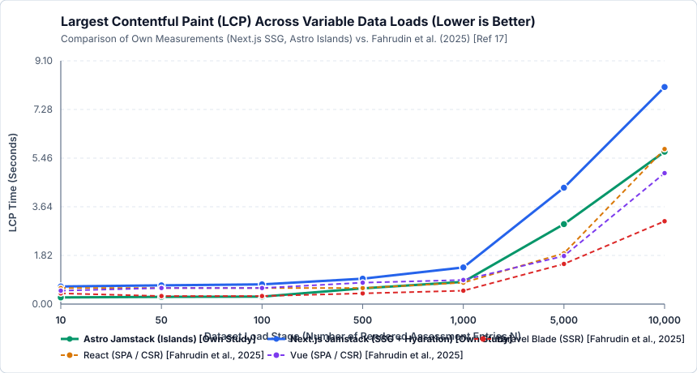
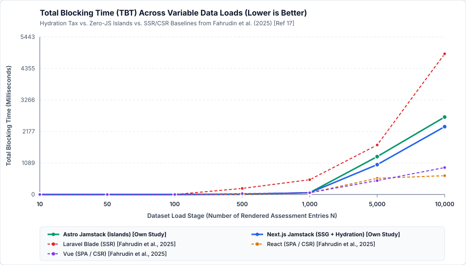

# Research Methods – Web Application Architecture Performance Experiment

**Hochschule Campus Wien** | Master-Lehrveranstaltung: *Research Methods (SS 2026)*  
**Lehrveranstaltungsleitung:** Prof. Slaviša Aleksić, Prof. Aleksandar Pavlović  
**Team B – Gruppe 4:** Fabio Gschweidl, Desirée Iris Hackl, Marco Miklautz, Lorenz Schneider, Danijel Trailovic

---

## 1. Projektziel & Präzisierte Research Question (Topic #14)

Dieses Repository enthält den vollständigen experimentellen Versuchsaufbau, die beiden **Jamstack-Benchmark-Prototypen (Next.js SSG vs. Astro Islands)**, die automatisierte **Google-Lighthouse-Messpipeline** sowie die **fertige wissenschaftliche Ausarbeitung** zum Thema:
> **Topic #14:** *Evaluate the impact of web application architecture on performance. Provide technical advice for scalable design of a specific web application architecture.*

### Präzisierte Forschungsfrage (Refined Research Question)
> *"How do modern Jamstack rendering architectures—specifically Static Site Generation with full React hydration (Next.js) versus Zero-JS Islands Architecture (Astro)—impact Core Web Vitals (FCP, LCP, TBT, CLS) and Speed Index under scaling data loads ($10$ to $10,000$ entries) compared to traditional Server-Side Rendering (Laravel Blade) and Client-Side Rendering (React, Vue), and what technical design guidelines can be derived for scalable web applications?"*

---

## 2. Wichtigste Dokumente & Ergebnisse im Repository

| Dokument / Pfad | Beschreibung |
| :--- | :--- |
| **[`ausarbeitung-methodik-und-ergebnisse.md`](./ausarbeitung-methodik-und-ergebnisse.md)** | **Fertige wissenschaftliche Ausarbeitung (Paper-Textvorlage)** inkl. *Abstract* (Past Tense, Passive Voice), *Scenario*, *Methodology* (DOT-Framework + alle 4 Benchmarking-Fragen aus Vorlesung 04), *Results* & *Technical Advice*. |
| **[`benchmarks/results/comparison-report.md`](./benchmarks/results/comparison-report.md)** | **Vollständiger Benchmark-Bericht** ($n = 5$ Runs pro Stufe, $\mu \pm \sigma$) im direkten Vergleich mit **Fahrudin et al. (2025) [Ref 17]** (*Blade SSR, React CSR, Vue CSR*) inkl. SVG-Diagrammen. |
| **[`benchmarks/results/summary-stats.csv`](./benchmarks/results/summary-stats.csv)** | Aggregierte statistische Kennzahlen (Mittelwert $\mu$, Standardabweichung $\sigma$, Median) über alle 7 Datenlast-Stufen (`10` bis `10.000`). |
| **[`benchmarks/results/raw-runs.csv`](./benchmarks/results/raw-runs.csv)** | Alle **70 Einzelmessungen** (`2 Architekturen × 7 Datenstufen × 5 Wiederholungen`) als Rohdaten-CSV und JSON (`raw-runs.json`). |
| **[`architektur-uebersicht.md`](./architektur-uebersicht.md)** | Verständliche Team-Übersicht zu **CSR (SPA)**, **SSR**, **Jamstack (SSG)** und **Islands Architecture** inkl. Vor-/Nachteilen. |
| **[`AGENTS.md`](./AGENTS.md)** | Vollständiger Projekt-Kontext, Vorlesungsanforderungen (*03-Methodology* & *04-Documentation*) und Referenzwerte aus [17]. |

---

## 3. Überblick der empirischen Kernergebnisse ($\mu \pm \sigma$, Desktop Preset, $n = 5$)

| Architektur | $N = 10$ (LCP / TBT) | $N = 100$ (LCP / TBT) | $N = 1.000$ (LCP / TBT) | $N = 5.000$ (LCP / TBT) | $N = 10.000$ (LCP / TBT) |
| :--- | :---: | :---: | :---: | :---: | :---: |
| **Astro Jamstack (Islands)** *(Eigene Messung)* | **0.25s** / **0 ms** | **0.28s** / **0 ms** | 0.83s / 62 ms | 2.99s / 1308 ms | 5.70s / 2676 ms |
| **Next.js Jamstack (SSG + Hydration)** *(Eigene Messung)* | 0.66s / **0 ms** | 0.74s / **0 ms** | 1.37s / **60 ms** | 4.35s / 1031 ms | 8.12s / 2344 ms |
| **Laravel Blade (SSR)** *(Fahrudin et al. [17])* | 0.40s / **0 ms** | 0.30s / **0 ms** | **0.50s** / 510 ms | **1.50s** / 1710 ms | **3.10s** / 4860 ms |
| **React (CSR / SPA)** *(Fahrudin et al. [17])* | 0.60s / **0 ms** | 0.60s / **0 ms** | 0.80s / **60 ms** | 1.90s / 560 ms | 5.80s / **650 ms** |
| **Vue.js (CSR / SPA)** *(Fahrudin et al. [17])* | 0.50s / **0 ms** | 0.60s / **0 ms** | 0.90s / **60 ms** | 1.80s / **480 ms** | 4.90s / 930 ms |

### Generierte Vergleichsdiagramme (Null-Basislinie gemäß Vorlesung 04)
- **Largest Contentful Paint (LCP):**  
  
- **Total Blocking Time (TBT):**  
  

---

## 4. Repository-Struktur & Reproduzierbarkeit

```text
research-methods-experiment/
├── apps/
│   ├── jamstack-nextjs/          # Next.js 15 (Static Export + Full React Hydration)
│   └── jamstack-astro/           # Astro 5 (Static Build + Zero-JS Table & Filter Island)
├── data/
│   ├── generate-data.mjs         # Deterministischer PRNG-Generator (Seed: 20260414)
│   └── generated/                # Generierte JSON-Datensätze (10..10.000 Einträge)
├── shared/
│   └── styles.css                # Gemeinsames Ceteris-Paribus CSS-Stylesheet
├── benchmarks/
│   ├── run-lighthouse.mjs        # Automatisierter Google Lighthouse Desktop Runner (n=5)
│   ├── analyze-results.mjs       # Statistik-Auswertung (Mean, SD, Median) & SVG-Generator
│   └── results/                  # Rohdaten (CSV/JSON), Tabellen & SVG-Liniendiagramme
├── ausarbeitung-methodik-und-ergebnisse.md
├── architektur-uebersicht.md
├── naechstes-vorgehen.md
├── AGENTS.md
└── README.md
```

### 4.1 Applikationen lokal im Browser ansehen (OHNE Benchmark-Test)

Wenn ihr euch die beiden gebauten Web-Applikationen (**Next.js** und **Astro**) einfach im eigenen Browser anschauen und durch die verschiedenen Datenmengen (`10` bis `10.000` Einträge) klicken wollt, braucht ihr **keinen** Lighthouse-Benchmark zu starten.

#### Schritt 1: Einmalig Abhängigkeiten installieren (im Hauptverzeichnis des Repos)
```bash
npm install
npm --prefix apps/jamstack-nextjs install
npm --prefix apps/jamstack-astro install
```

#### Schritt 2 (Option A – Schnellster Weg im Entwicklungsmodus / Dev-Server):
Startet einfach eine (oder in zwei Terminal-Fenstern beide) Applikationen direkt aus dem Hauptverzeichnis. Die Testdaten (`10` bis `10.000` Einträge) werden dabei automatisch vorab generiert:

- **Next.js App starten (Port 3001):**
  ```bash
  npm run dev:nextjs
  ```
  👉 Öffnet im Browser: **http://localhost:3001** (oder direkt z. B. **http://localhost:3001/assessments/100**)

- **Astro Islands App starten (Port 3002):**
  ```bash
  npm run dev:astro
  ```
  👉 Öffnet im Browser: **http://localhost:3002** (oder direkt z. B. **http://localhost:3002/assessments/100**)

#### Schritt 2 (Option B – Als fertiger Produktions-Build wie im echten Experiment):
Wenn ihr exakt die vorab generierten statischen HTML-Seiten (*Static Site Generation*) testen wollt, wie sie auch im Experiment gemessen wurden:

```bash
# 1. Einmalig Datensätze generieren & beide Produktions-Builds erstellen
npm run build

# 2a. Next.js Production-Build auf Port 3001 starten:
npm run start:nextjs

# 2b. (Oder in einem 2. Terminal) Astro Production-Build auf Port 3002 starten:
npm run start:astro
```

#### Verfügbare Seiten / URLs in beiden Apps:
Auf der Startseite (`http://localhost:3001` bzw. `http://localhost:3002`) könnt ihr oben über die Navigationsleiste direkt zwischen allen **7 Datenlast-Stufen** wechseln und auch die **Such-/Filterfunktion sowie den Sortier-Button** ausprobieren:
- `/assessments/10` (10 Einträge)
- `/assessments/50` (50 Einträge)
- `/assessments/100` (100 Einträge)
- `/assessments/500` (500 Einträge)
- `/assessments/1000` (1.000 Einträge)
- `/assessments/5000` (5.000 Einträge)
- `/assessments/10000` (10.000 Einträge)

---

### 4.2 Optional: Automatisierten Google-Lighthouse-Benchmark komplett neu ausführen

*(Nur nötig, wenn ihr alle 70 Lighthouse-Messungen noch einmal komplett neu durchlaufen lassen wollt)*

```bash
# 1. Datensätze generieren & beide Apps bauen
npm run build

# 2. Automatisierten Google Lighthouse Benchmark starten (Standard: n=5 Durchläufe pro Stufe = 70 Runs)
npm run benchmark

# 3. Statistische Auswertung, Vergleichstabellen mit [17] & SVG-Diagramme generieren
npm run analyze
```

---

## 5. Referenzierte Primärstudien
1. **Fahrudin, T. M., Wijaya, I. D., & Nasyuha, A. H. (2025) [Ref 17]:** *Performance Comparison of Blade, Vue, and React Under Variable Data Loads*. 2025 International Conference on Computer Science, Information Technology and Engineering (ICCoSITE), IEEE, pp. 904–909. doi: `10.1109/ICCoSITE64204.2025.10939821`.
2. **Lonka, O. (2023) [Ref 30]:** *Performance comparison of two full-stack web frameworks: Astro and Next.js*. Bachelor's Thesis, University of Oulu.
3. **Yavuz, T., & Miladinovic, I. (2023) [Ref 2]:** *Rendering Performance Analysis of Modern JavaScript Frameworks*. ICICT 2023.
4. **Đurić, M. (2025) [Ref 20]:** *Comparative Analysis of Client-Side and Server-Side Rendering in React Web Applications*.
5. **Shitov, I. (2025) [Ref 6]:** *Comparative Performance Analysis of Client-Side and Server-Side Rendering across Varying Hardware Configurations*.
