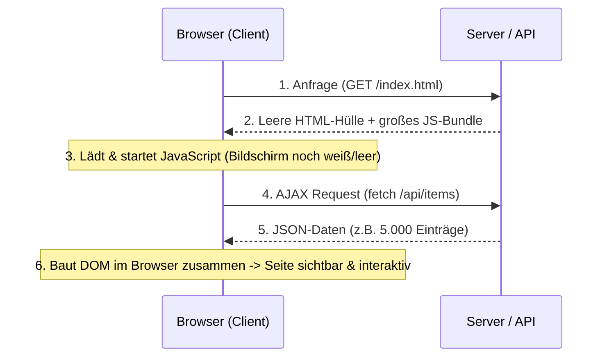
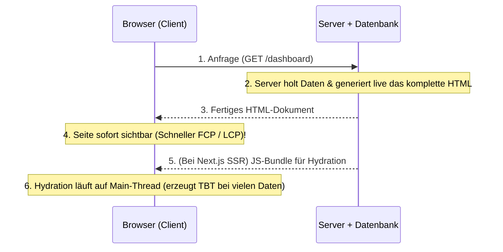
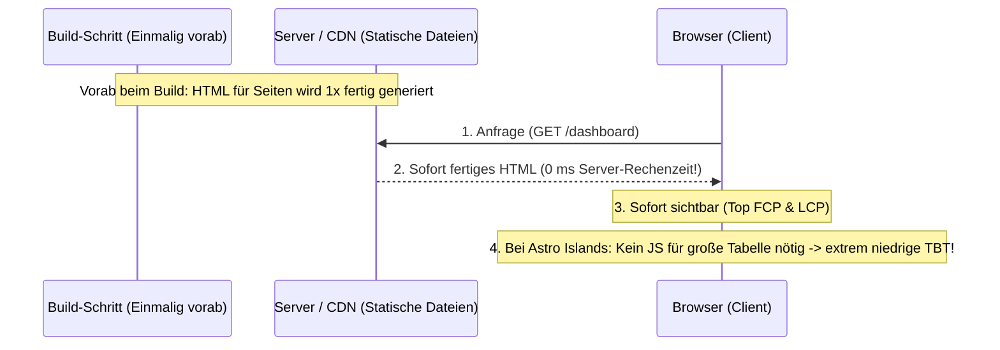

# Architektur-Übersicht: CSR (SPA mit AJAX) vs. SSR vs. Jamstack (SSG & Islands)

Diese Übersicht erklärt für unser gesamtes Team (**Team B – Gruppe 4**) die wichtigsten Begriffe, Abläufe sowie Vor- und Nachteile der Web-Architekturen, die wir in unserer Research Question und im Vergleich zu **Fahrudin et al. (2025) [Ref 17]** untersuchen.

---

## 1. Die 3 Rendering-Architekturen einfach erklärt

### A) CSR / SPA mit AJAX (*Client-Side Rendering / Single-Page Application*)
* **Typische Frameworks:** Klassisches React (Vite / Create-React-App), Vue.js, Angular.
* **Wie funktioniert es?**
  1. Der User ruft die Webseite im Browser auf.
  2. Der Server schickt **nur eine fast leere HTML-Datei** (`

`) und ein großes JavaScript-Paket (Bundle) zurück.
  3. Der Browser muss dieses JavaScript zuerst herunterladen und ausführen.
  4. Danach holt sich das JavaScript im Browser per **AJAX (`fetch`)** die eigentlichen Daten (z. B. 1.000 Datensätze als JSON) vom Server und baut daraus die sichtbare Seite im Browser zusammen.

* **Vorteile:**
  * **Flüssige Navigation nach dem ersten Laden:** Wenn man innerhalb der App weiterklickt, muss die Seite nicht neu geladen werden.
  * **Geringe Serverlast für das HTML:** Der Server liefert nur statische JS-Dateien und JSON-Daten aus – die Rechenarbeit für das Zeichnen der Oberfläche macht das Gerät des Nutzers.
* **Nachteile:**
  * **Langsamer Initial Load (schlechter FCP & LCP):** Beim ersten Aufruf sieht der User länger einen weißen Bildschirm oder Lade-Spinner, weil erst HTML $\rightarrow$ JavaScript $\rightarrow$ AJAX-Daten nacheinander geladen werden müssen.
  * **Schlecht für schwache Geräte (Smartphones) & SEO:** Auf langsamen Handys dauert das Ausführen des JavaScripts bei großen Datenmengen sehr lange.

---

### B) SSR (*Server-Side Rendering*)
* **Typische Frameworks:** Laravel Blade (aus unserer Referenzstudie Fahrudin et al. [17]), klassisches PHP, oder modernes SSR mit Next.js / Nuxt.js / Angular Universal.
* **Wie funktioniert es?**
  1. Der User ruft die Webseite im Browser auf.
  2. **Bei jeder einzelnen Anfrage** holt der Server die Daten aus der Datenbank, baut daraus auf dem Server das **komplette, fertige HTML** (inkl. aller 1.000 oder 10.000 Tabellenzeilen) zusammen und schickt es an den Browser.
  3. Der Browser empfängt das fertige HTML und kann es **sofort anzeigen** (sehr schneller *First Contentful Paint*).
  4. **Wichtiger Zusatzbegriff – *Hydration* (bei Next.js SSR):** Damit Buttons, Filter und Menüs im Browser klickbar werden, lädt der Browser im Hintergrund trotzdem noch das React-JavaScript herunter und "verheiratet" es mit dem sichtbaren HTML (*Hydration*). Während dieser Hydration ist die Seite zwar schon sichtbar, reagiert aber manchmal kurzzeitig noch nicht auf Klicks.

* **Vorteile:**
  * **Schneller erster Seitenaufbau (FCP & LCP):** Der Browser bekommt sofort fertiges HTML und muss nicht erst auf AJAX-Requests im Browser warten.
  * **Sehr gutes SEO:** Suchmaschinen sehen sofort den kompletten Textinhalt.
  * **Immer aktuelle Daten:** Da die Seite bei jedem Aufruf frisch am Server gebaut wird.
* **Nachteile:**
  * **Hohe Serverlast bei *Traffic Spikes / Concurrent Users*:** Wenn 500 User gleichzeitig die Seite aufrufen, muss der Server 500-mal live die Datenbank abfragen und das HTML neu berechnen (Server wird zum Flaschenhals!).
  * **Hohe *Total Blocking Time (TBT)* bei großen Datenmengen:** Wie **Fahrudin et al. (2025) [Ref 17]** bewiesen haben, wird das HTML ab 5.000–10.000 Einträgen riesig, und das Parsen/Hydrieren blockiert den Browser massiv (TBT steigt bei 10.000 Einträgen auf $2.790\text{ ms}$!).

---

### C) Jamstack / SSG & Islands Architecture (*Static Site Generation*)
* **Typische Frameworks:** **Astro** (*Islands Architecture*) und **Next.js** (*Static Site Generation / SSG*).
* **Was bedeutet Jamstack?** **J**avaScript, **A**PIs und vorberechnetes **M**arkup (HTML).
* **Wie funktioniert es?**
  1. Das HTML wird **nicht** erst im Browser gebaut (wie bei CSR) und auch **nicht** bei jeder User-Anfrage live am Server berechnet (wie bei SSR), sondern **einmalig vorab beim Build-Prozess (Static Site Generation – SSG)** fertig generiert.
  2. Die fertigen HTML-Dateien liegen abrufbereit auf einem Webserver oder CDN.
  3. Wenn ein User (oder 10.000 User gleichzeitig!) die Seite aufruft, schickt der Server ohne jede Rechenzeit sofort die fertige Datei.
* **Der spannende Unterschied zwischen Next.js (SSG) und Astro (Islands) für unser Experiment:**
  * **Next.js (Jamstack SSG):** Liefert zwar vorab generiertes HTML aus, führt aber im Browser trotzdem eine **React Hydration** über die Seite durch.
  * **Astro (Jamstack + Islands Architecture):** Liefert standardmäßig **0 KB JavaScript (Zero-JS Default)** für das gesamte HTML aus! Die große Tabelle mit 1.000 oder 10.000 Einträgen bleibt reines, leichtgewichtiges HTML (keine Hydration nötig!). Nur kleine interaktive Bereiche (z. B. ein Suchfeld oder ein Filter-Widget) werden als isolierte **"Insel" (*Astro Island*)** mit minimalem JavaScript geladen.

* **Vorteile:**
  * **Maximale Geschwindigkeit beim Laden (FCP & LCP):** Fertiges HTML ist sofort da.
  * **Perfekte Stabilität bei *Traffic Spikes & Concurrent Users*:** Da der Server nichts live berechnen muss, sondern nur fertige Dateien ausliefert, verkraftet er extrem viele gleichzeitige Nutzer problemlos.
  * **Minimale Blockierzeit (TBT) bei Astro Islands:** Weil die große Datenliste nicht hydriert werden muss, bleibt der Browser sofort interaktiv.
* **Nachteile:**
  * **Build-Zeit:** Wenn sich Daten ändern, müssen statische Seiten neu gebaut oder inkrementell aktualisiert werden (*Incremental Static Regeneration – ISR* oder Nachladen einzelner dynamischer Inseln).

---

## 2. Direkter Vergleich auf einen Blick (Spickzettel für Paper & Präsentation)

| Kriterium | CSR / SPA mit AJAX (z. B. React + Vite) | Klassisches / Modernes SSR (z. B. Blade / Next.js SSR) | Jamstack SSG + Full Hydration (z. B. Next.js SSG) | Jamstack + Islands Architecture (z. B. Astro) |
| :--- | :--- | :--- | :--- | :--- |
| **Wo wird das HTML erzeugt?** | Im Browser des Users (zur Laufzeit) | Auf dem Server (bei **jedem** Request neu) | Vorab beim Build (SSG) | Vorab beim Build (SSG) |
| **Initiale Ladezeit (FCP & LCP)** | ❌ Langsam (muss erst JS + AJAX laden) | ✅ Schnell (fertiges HTML kommt vom Server) | ✅ Sehr schnell (fertiges HTML liegt bereit) | ✅ Sehr schnell (fertiges HTML + kaum JS) |
| **Browser-Blockierung (TBT) bei vielen Daten ($N \ge 5.000$)** | ✅ Niedrig nach dem Laden (aber sehr langsamer Start) | ❌ Hoch (großes HTML + evtl. Hydration blockiert Main-Thread) | ⚠️ Mittel bis Hoch (React muss alle Knoten hydrieren) | ✅ Extrem niedrig (Tabelle bleibt reines HTML ohne JS-Hydration) |
| **Stabilität bei Traffic Spikes / Concurrent Users** | ✅ Gut für statisches JS, aber API muss JSON liefern | ❌ Schwachpunkt (Server muss für jeden User HTML neu rendern) | ✅ Exzellent (nur statische Dateien vom Server/CDN) | ✅ Exzellent (nur statische Dateien vom Server/CDN) |
| **SEO (Suchmaschinen)** | ❌ Schwierig (ohne Pre-Rendering leeres HTML) | ✅ Perfekt | ✅ Perfekt | ✅ Perfekt |

---

## 3. Was bedeuten die Google-Lighthouse-Metriken?

Damit jeder im Team weiß, was die Kennzahlen in **Fahrudin et al. (2025) [Ref 17]** und in unseren eigenen Messungen bedeuten:

1. **FCP (*First Contentful Paint* – in Sekunden/Millisekunden):**
   * *Was wird gemessen?* Wie lange dauert es nach dem Aufruf, bis das **allererste sichtbare Element** (Text, Überschrift, Bild) auf dem Bildschirm erscheint?
   * *Faustregel:* Gut ist unter **1,8 Sekunden**.
2. **LCP (*Largest Contentful Paint* – in Sekunden/Millisekunden):**
   * *Was wird gemessen?* Wie lange dauert es, bis der **Hauptinhalt der Seite** (das größte sichtbare Element im Viewport, z. B. unsere Datentabelle) fertig gerendert ist? Das ist Googles wichtigste Metrik für die **Ladezeit (Load Time)**.
   * *Faustregel:* Gut ist unter **2,5 Sekunden**.
3. **SI (*Speed Index* – in Sekunden/Millisekunden):**
   * *Was wird gemessen?* Wie schnell füllt sich der sichtbare Bildschirm optisch während des Ladens? (Ein niedrigerer Wert bedeutet eine höhere wahrgenommene **Rendering Speed**).
   * *Faustregel:* Gut ist unter **3,4 Sekunden**.
4. **TBT (*Total Blocking Time* – in Millisekunden):**
   * *Was wird gemessen?* Wie viele Millisekunden zwischen FCP und vollständiger Interaktivität ist der Haupt-Thread des Browsers durch lange JavaScript-/Rendering-Aufgaben ($> 50\text{ ms}$) **blockiert**, sodass der User **nicht klicken oder tippen** kann?
   * *Faustregel:* Gut ist unter **200 ms**. *(Bei Fahrudin et al. [17] stieg dieser Wert bei 10.000 Einträgen in SSR auf **2.790 ms**, also fast 3 Sekunden komplettes Einfrieren!)*
5. **CLS (*Cumulative Layout Shift* – dimensionsloser Score):**
   * *Was wird gemessen?* Verschieben sich Elemente beim Nachladen ruckartig auf dem Bildschirm (z. B. wenn Daten per AJAX erst später reinkommen)?
   * *Faustregel:* Gut ist unter **0,1** (optimal ist **0**).
6. **10-Sekunden-Grenze nach Jakob Nielsen (*Usability Engineering*):**
   * Die obere Toleranzschwelle der menschlichen Aufmerksamkeit beim Laden einer Seite: Dauert das Laden länger als **10 Sekunden**, brechen Nutzer die Nutzung ab. Fahrudin et al. [17] nutzen diesen Wert als Abbruch-/Schwellenwert für große Datenmengen.
