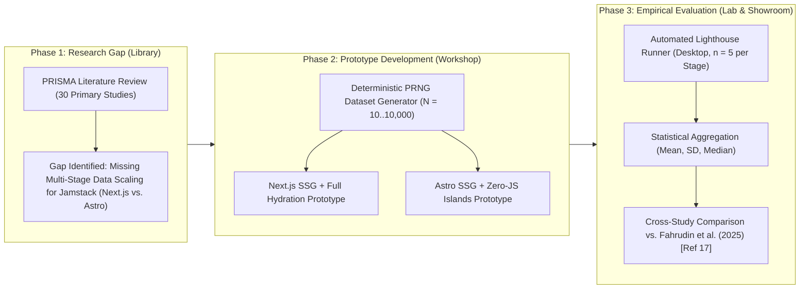
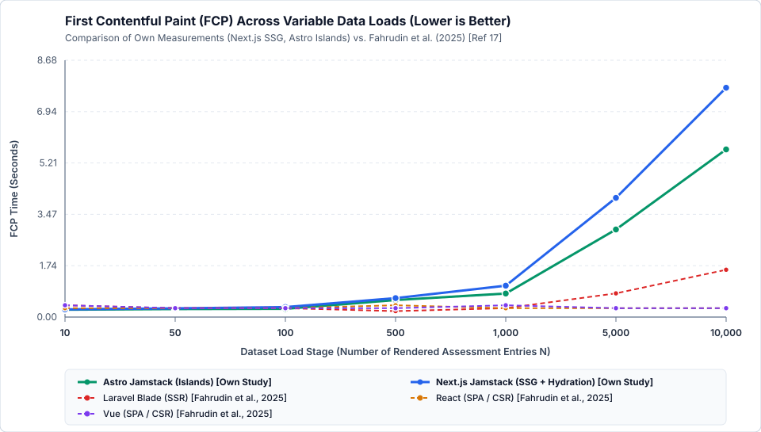
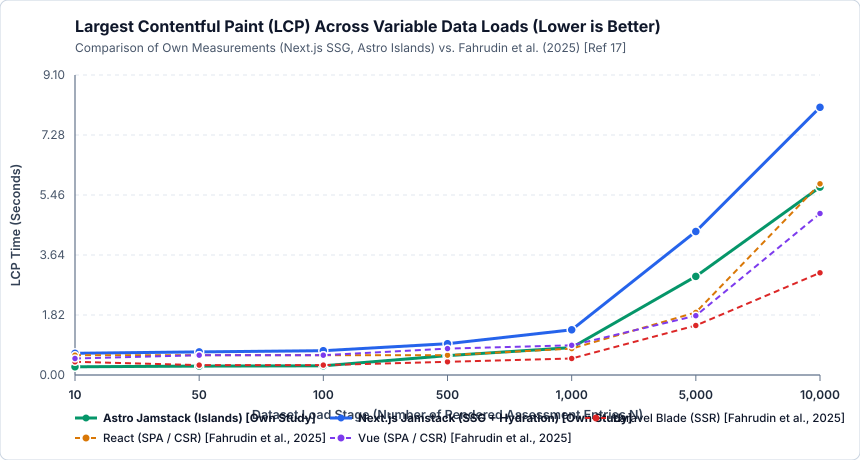
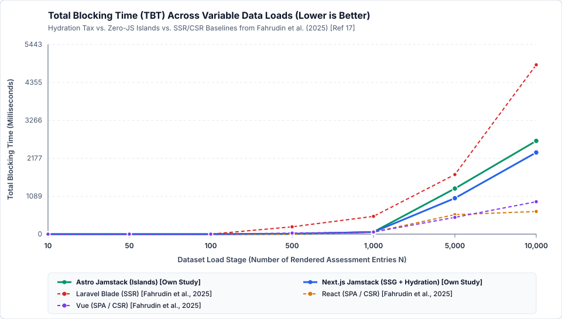
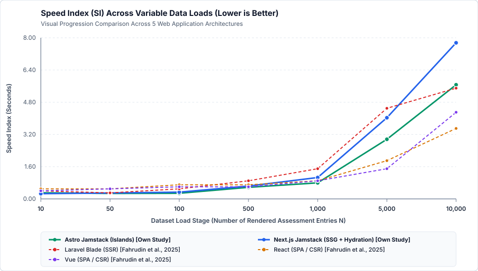
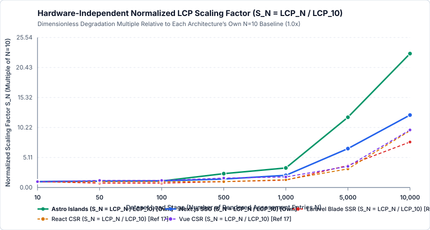

# Wissenschaftliche Ausarbeitung: Scenario, Methodology, Results & Discussion
**Kurs:** Research Methods (SS 2026) – Hochschule Campus Wien  
**Lehrende:** Prof. Slaviša Aleksić, Prof. Aleksandar Pavlović  
**Team B – Gruppe 4:** Fabio Gschweidl, Desirée Iris Hackl, Marco Miklautz, Lorenz Schneider, Danijel Trailovic  
**Thema (#14):** *Evaluate the impact of web application architecture on performance. Provide technical advice for scalable design of a specific web application architecture.*

---

## 0. Präzisierte Research Question (angepasst gemäß Team-Entscheidung 5B)

Da die empirische Untersuchung auf Google Lighthouse über systematisch skalierende Datenlasten ($N \in \{10, 50, 100, 500, 1.000, 5.000, 10.000\}$ Datensätze) in direkter Anknüpfung an **Fahrudin et al. (2025) [17]** fokussiert, lautet die präzisierte Forschungsfrage:

> **Refined Research Question (EN):**  
> *"How do modern Jamstack rendering architectures—specifically Static Site Generation with full React hydration (Next.js) versus Zero-JS Islands Architecture (Astro)—impact Core Web Vitals (FCP, LCP, TBT, CLS) and Speed Index under scaling data loads ($10$ to $10,000$ entries) compared to traditional Server-Side Rendering (Laravel Blade) and Client-Side Rendering (React, Vue), and what technical design guidelines can be derived for scalable web applications?"*

> **Präzisierte Forschungsfrage (DE):**  
> *„Wie beeinflussen moderne Jamstack-Rendering-Architekturen – konkret Static Site Generation mit vollständiger React-Hydration (Next.js) im Vergleich zur Zero-JS Islands Architecture (Astro) – die Core Web Vitals (FCP, LCP, TBT, CLS) sowie den Speed Index unter skalierenden Datenlasten ($10$ bis $10.000$ Einträge) im Vergleich zu klassischem Server-Side Rendering (Laravel Blade) und Client-Side Rendering (React, Vue), und welche technischen Entwurfsrichtlinien lassen sich daraus für skalierbare Webapplikationen ableiten?“*

---

## 1. Abstract (Vorlage nach *04-Documentation*, Folie 68)
*(Stilvorgabe laut Vorlesung: **Past Tense & Passive Voice**, **keine Zitate**, **keine URLs**, Fokus auf haupterzielte quantitative Ergebnisse.)*

> Modern web applications increasingly rely on pre-rendering and hybrid client-side hydration strategies to balance initial loading speed and rich interactivity. While traditional Server-Side Rendering and Client-Side Rendering architectures have been extensively benchmarked under scaling dataset workloads, the quantitative impact of full-page hydration versus partial Islands hydration within the Jamstack paradigm remains insufficiently characterized across extreme DOM sizes. In this study, two functionally and visually identical Academic Assessment Management prototypes were implemented using Next.js (Static Site Generation with full React hydration) and Astro (Static Site Generation with Zero-JS Islands Architecture). Both architectures were evaluated across seven exponentially increasing dataset stages ranging from 10 to 10,000 rendered records using automated Google Lighthouse desktop audits with five repetitions per configuration. The empirical results were subsequently compared against established baseline metrics for Server-Side Rendering and Client-Side Rendering. At small to medium workloads up to 500 records, both Jamstack architectures achieved near-optimal performance scores between 98.4 and 100.0, with the Islands Architecture reducing Largest Contentful Paint by up to 62% (0.25 s versus 0.66 s at 10 records) by eliminating client-side JavaScript bundle overhead. Under heavy data loads of 10,000 records (approximately 190,000 DOM nodes), full React hydration incurred a substantial double-payload penalty (9,343.2 kB HTML versus 6,760.2 kB in Astro), resulting in a Largest Contentful Paint of 8.12 s compared to 5.70 s for Astro Islands. However, both Jamstack variants reduced Total Blocking Time at 10,000 records by more than 44% compared to traditional monolithic Server-Side Rendering (2,344.0 ms and 2,675.5 ms versus 4,860.0 ms). Based on these findings, concrete architectural thresholds and technical guidelines for DOM virtualization, pagination, and selective hydration are derived.

---

## 2. Scenario (Vorlage nach *04-Documentation*, Folien 22–32)
*(Stilvorgabe laut Vorlesung: Strikte Trennung von der Methodology! Beschreibt **Was** untersucht wurde und unter welchen **Randbedingungen / Boundary Conditions**; geschrieben in **Past Tense & Active Voice**.)*

### 2.1 Application Domain and Prototype Design
To ensure direct cross-study comparability with the reference benchmark by Fahrudin et al. [17], we modeled the experimental testbed as an **Academic Assessment Management System**. Each view rendered four summary Key Performance Indicator (KPI) cards (total entries, mean score, pass rate, and retake counter), an interactive multi-criteria filter toolbar (text search across student names, IDs, and courses, plus status and course dropdown filters), and a structured 13-column assessment data table (`ID`, `Student ID`, `Student Name`, `Course`, `Category`, `Assessment Type`, `Semester`, `ECTS`, `Score`, `Grade`, `Status`, `Evaluated Date`, and an interactive `Flag` action button).

We implemented two distinct Jamstack prototypes under strict *ceteris paribus* boundary conditions:
1. **Next.js Prototype (`apps/jamstack-nextjs`, v15.5.29, React 19.0.0):** We configured Next.js with `output: 'export'` to pre-render all dataset views into static HTML files at build time via `generateStaticParams()`. To support client-side filtering and row flagging within the React component model, the dashboard component (`AssessmentDashboardClient`) hydrated the pre-rendered DOM on the client, shipping a shared React runtime bundle of `350.5 kB` alongside the serialized React Server Component (RSC) hydration payload embedded in the HTML document.
2. **Astro Prototype (`apps/jamstack-astro`, v5.5.0):** We configured Astro with `output: 'static'` using `getStaticPaths()`. Following the **Islands Architecture** pattern [30], Astro compiled the KPI cards and the entire $N$-row assessment table into pure, zero-JavaScript static HTML. We isolated client-side interactivity to a lightweight inline script (`< 1.2 kB`, `0.0 kB` external JavaScript bundle) that filtered existing DOM rows via `data-*` attributes and event delegation without constructing a Virtual DOM in browser memory.

Both prototypes imported the exact same CSS stylesheet (`shared/styles.css`) and produced identical visual layouts and DOM structures (~19 DOM nodes per assessment row, scaling from `265` DOM elements at $N = 10$ to `190,075` DOM elements at $N = 10,000$).

### 2.2 Dataset Workload Stages
We generated seven deterministic JSON datasets using a seeded Mulberry32 pseudo-random number generator (`SEED = 20260414` in `data/generate-data.mjs`), matching the exact seven workload stages defined by Fahrudin et al. [17]:
- **Small Workloads:** $N \in \{10, 50, 100\}$ entries (`3.4 kB` to `34.1 kB` raw JSON)
- **Medium Workloads:** $N \in \{500, 1,000\}$ entries (`170.4 kB` to `340.3 kB` raw JSON)
- **Large Workloads:** $N \in \{5,000, 10,000\}$ entries (`1,701.8 kB` to `3,403.4 kB` raw JSON)

### 2.3 Hardware and Software Environment
We executed all builds and automated Lighthouse benchmarks on an isolated Linux virtual machine with the following specifications:
- **Operating System:** Debian GNU/Linux 12 (Bookworm), Kernel `Linux 6.12.105+ (x86_64)`
- **Processor:** Intel(R) Xeon(R) 6985P-C (2 logical vCPU cores)
- **Memory:** `7.76 GB` RAM
- **Runtime & Build Tooling:** Node.js `v24.22.2`, npm `11.21.2`
- **Browser & Auditing Engine:** Headless Chromium `156.0.8078.79` controlled via Google Lighthouse `v12.4.0` (`chrome-launcher v1.2.0`) in Desktop preset mode (`1350x940` viewport, `rttMs: 40`, `throughputKbps: 10240`, `cpuSlowdownMultiplier: 1`).

---

## 3. Methodology (Vorlage nach *03-Methodology* & *04-Documentation*, Folien 33–45)
*(Stilvorgabe laut Vorlesung: Dreischritt aus **Research Gap Identification $\rightarrow$ Development $\rightarrow$ Evaluation**, Einbettung in das **DOT-Framework** sowie explizite Beantwortung der **4 Benchmarking-Fragen** aus Folie 42–45; geschrieben in **Past Tense & Active Voice**.)*

### 3.1 Research Design within the Development Oriented Triangulation (DOT) Framework
To achieve both high internal validity (controlled isolation of rendering overhead) and high contextual relevance, we structured our research methodology using the **Development Oriented Triangulation (DOT) Framework**:
1. **Library (*Literature Analysis*):** In the preceding phase, we conducted a systematic literature review following the PRISMA 2020 protocol across IEEE Xplore, ACM Digital Library, SpringerLink, ScienceDirect, and Google Scholar, yielding 30 primary studies. Our synthesis revealed that while traditional Server-Side Rendering (SSR) and Client-Side Rendering (CSR) had been systematically evaluated across scaling dataset sizes ($10$ to $10,000$ entries) by Fahrudin et al. [17], and Astro had been compared against Next.js at fixed page sizes by Lonka [30], no study had quantified how **Jamstack Static Site Generation with full React hydration (Next.js)** versus **Jamstack Islands Architecture (Astro)** scales across those exact seven dataset thresholds.
2. **Workshop (*Prototype Engineering*):** We developed two functionally equivalent web applications (`apps/jamstack-nextjs` and `apps/jamstack-astro`) sharing a deterministic dataset generator (`data/generate-data.mjs`) and a unified stylesheet (`shared/styles.css`).
3. **Lab (*Experimental Benchmarking*) & Showroom (*Comparative Normative Evaluation*):** We conducted controlled laboratory measurements using Google Lighthouse across 14 experimental configurations ($2 \text{ architectures} \times 7 \text{ workload stages} \times 5 \text{ repetitions} = 70 \text{ total runs}$) and benchmarked the resulting performance curves against the reference baselines from Fahrudin et al. [17].

### 3.2 Explicit Justification of the Benchmarking Setup (Lecture 04, Slides 42–45)
In accordance with established empirical software engineering guidelines, we explicitly address the four foundational benchmarking design questions:

1. **Which baselines did we choose for comparison, and why?**  
   We selected the three architectural baselines evaluated by Fahrudin et al. (2025) [17]—**Laravel Blade (traditional SSR)**, **React (CSR/SPA)**, and **Vue.js (CSR/SPA)**—and juxtaposed them with our two Jamstack implementations: **Next.js (SSG with full React hydration)** and **Astro (SSG with Zero-JS Islands)**. This selection spans the complete spectrum of modern web rendering paradigms: on-demand server rendering (SSR), pure browser-side rendering (CSR), build-time pre-rendering with full Virtual DOM hydration (Next.js), and build-time pre-rendering with partial/isolated hydration (Astro). Because [17] already established empirical Desktop Lighthouse curves for React CSR, Vue CSR, and Blade SSR across $N = 10$ to $10,000$ records, reusing their peer-reviewed baselines allowed us to isolate the exact architectural contribution of Jamstack pre-rendering and Islands hydration without redundant re-implementation of CSR.

2. **Which datasets were used for testing, and why?**  
   We tested seven discrete workload stages: **$N \in \{10, 50, 100, 500, 1,000, 5,000, 10,000\}$ assessment entries**. We chose these exact seven gradations for two reasons: first, they mirror the exact workload stages of Fahrudin et al. [17], enabling a direct stage-by-stage comparison; second, they cover three distinct browser execution regimes—*light DOM loads* ($10$–$100$ rows, $< 2,000$ DOM nodes), *moderate DOM loads* ($500$–$1,000$ rows, $9,500$–$19,000$ DOM nodes, crossing Google Lighthouse's recommended 1,500-node threshold), and *extreme stress loads* ($5,000$–$10,000$ rows, $95,000$–$190,000$ DOM nodes), where main-thread HTML parsing, layout recalculation, and JavaScript hydration bottlenecks emerge clearly.

3. **Which metrics were chosen to evaluate performance, and why?**  
   We recorded the five standardized Google Lighthouse metrics reported in [17] alongside payload diagnostics:
   - **First Contentful Paint (FCP, in seconds):** Measures initial visual feedback latency and HTML delivery speed.
   - **Largest Contentful Paint (LCP, in seconds):** Core Web Vital measuring when the main assessment data table becomes visually complete in the viewport.
   - **Total Blocking Time (TBT, in milliseconds):** Core Web Vital proxy for First Input Delay (FID) / Interaction to Next Paint (INP), quantifying the sum of main-thread blocking periods ($> 50\text{ ms}$) between FCP and Time to Interactive (TTI). TBT directly captures the CPU cost of React hydration versus static HTML parsing.
   - **Speed Index (SI, in seconds):** Quantifies how quickly the visible viewport populates during page load.
   - **Cumulative Layout Shift (CLS, unitless):** Core Web Vital verifying visual layout stability during rendering and hydration.
   - **Transfer Payload & DOM Diagnostics (`html_kb`, `js_kb`, `dom_nodes`):** Explains the causal mechanisms behind the observed timing differences.

4. **How did we ensure comparability and statistical reliability?**  
   We enforced strict *ceteris paribus* controls across both prototypes: identical synthetic records (`SEED = 20260414`), identical CSS rules, identical DOM hierarchy, and an identical local Node.js HTTP server (`Cache-Control: immutable`) on loopback (`127.0.0.1`) to eliminate external wide-area network jitter. We launched Chromium in clean `--incognito` sessions with storage reset enabled (`disableStorageReset: false`) prior to every single run. To ensure statistical reliability and account for operating system scheduling variance, we executed **$n = 5$ independent Lighthouse repetitions** for each of the 14 architecture-stage combinations ($70$ total runs) and reported the arithmetic mean ($\mu$) and sample standard deviation ($\sigma$).

---

## 4. Empirical Results & Cross-Study Comparison (Vorlage nach *04-Documentation*, Folien 47–60)
*(Hinweis zur Darstellung laut Vorlesung: Beste Werte pro Zeile sind **fett** hervorgehoben [Folie 51]; alle Liniendiagramme besitzen eine Null-Basislinie auf der Y-Achse [Folie 55–57]; eigene Messwerte sind klar von den Referenzwerten aus Fahrudin et al. [17] getrennt [Folie 11].)*

### 4.1 Summary of Own Empirical Measurements ($\mu \pm \sigma$, $n = 5$ Runs per Stage)

| Architecture | Data Load ($N$) | Perf. Score ($\mu \pm \sigma$) | FCP [s] ($\mu \pm \sigma$) | LCP [s] ($\mu \pm \sigma$) | TBT [ms] ($\mu \pm \sigma$) | Speed Index [s] ($\mu \pm \sigma$) | CLS ($\mu$) | HTML Size [kB] | JS Bundle [kB] | DOM Elements |
| :--- | ---: | ---: | ---: | ---: | ---: | ---: | ---: | ---: | ---: | ---: |
| **Astro (Jamstack SSG + Islands)** | 10 | **100.0** (±0.0) | **0.250** (±0.027) | **0.250** (±0.027) | **0.0** (±0.0) | 0.304 (±0.077) | **0.0000** | **17.0** | **0.0** | **265** |
| **Astro (Jamstack SSG + Islands)** | 50 | **100.0** (±0.0) | **0.271** (±0.001) | **0.271** (±0.001) | **0.0** (±0.0) | **0.271** (±0.001) | **0.0000** | **43.8** | **0.0** | **1,025** |
| **Astro (Jamstack SSG + Islands)** | 100 | **100.0** (±0.0) | **0.278** (±0.008) | **0.278** (±0.008) | **0.0** (±0.0) | **0.278** (±0.008) | **0.0000** | **77.9** | **0.0** | **1,975** |
| **Astro (Jamstack SSG + Islands)** | 500 | **100.0** (±0.0) | **0.575** (±0.051) | **0.589** (±0.038) | **2.9** (±4.1) | **0.575** (±0.051) | **0.0000** | **348.1** | **0.0** | **9,575** |
| **Astro (Jamstack SSG + Islands)** | 1,000 | **98.4** (±0.5) | **0.797** (±0.034) | **0.832** (±0.039) | 62.1 (±29.3) | **0.797** (±0.034) | **0.0000** | **685.3** | **0.0** | **19,075** |
| **Astro (Jamstack SSG + Islands)** | 5,000 | **37.8** (±0.4) | **2.961** (±0.027) | **2.990** (±0.042) | 1307.9 (±67.6) | **2.961** (±0.027) | **0.0000** | **3385.2** | **0.0** | **95,075** |
| **Astro (Jamstack SSG + Islands)** | 10,000 | **26.0** (±0.0) | **5.667** (±0.006) | **5.700** (±0.009) | 2675.5 (±102.6) | **5.667** (±0.006) | **0.0000** | **6760.2** | **0.0** | **190,075** |
| **Next.js (Jamstack SSG + Hydration)** | 10 | **100.0** (±0.0) | 0.259 (±0.002) | 0.658 (±0.004) | **0.0** (±0.0) | **0.259** (±0.002) | **0.0000** | 18.6 | 350.5 | 275 |
| **Next.js (Jamstack SSG + Hydration)** | 50 | **100.0** (±0.0) | 0.295 (±0.007) | 0.701 (±0.002) | **0.0** (±0.0) | 0.295 (±0.007) | **0.0000** | 55.8 | 350.5 | 1,035 |
| **Next.js (Jamstack SSG + Hydration)** | 100 | **100.0** (±0.0) | 0.337 (±0.008) | 0.736 (±0.006) | **0.0** (±0.0) | 0.337 (±0.008) | **0.0000** | 102.9 | 350.5 | 1,985 |
| **Next.js (Jamstack SSG + Hydration)** | 500 | 98.4 (±0.5) | 0.640 (±0.022) | 0.950 (±0.077) | 10.4 (±16.2) | 0.640 (±0.022) | **0.0000** | 476.7 | 350.5 | 9,585 |
| **Next.js (Jamstack SSG + Hydration)** | 1,000 | 94.0 (±0.7) | 1.061 (±0.064) | 1.371 (±0.060) | **60.0** (±34.9) | 1.061 (±0.064) | **0.0000** | 943.0 | 350.5 | 19,085 |
| **Next.js (Jamstack SSG + Hydration)** | 5,000 | 31.2 (±0.4) | 4.030 (±0.092) | 4.353 (±0.006) | **1030.7** (±134.7) | 4.030 (±0.092) | **0.0000** | 4676.4 | 350.5 | 95,085 |
| **Next.js (Jamstack SSG + Hydration)** | 10,000 | 25.0 (±0.0) | 7.751 (±0.014) | 8.121 (±0.005) | **2344.0** (±251.8) | 7.751 (±0.014) | **0.0000** | 9343.2 | 350.5 | 190,085 |

---

### 4.2 Cross-Study Comparison Tables: Own Jamstack Measurements vs. Fahrudin et al. (2025) [Ref 17]

#### Table 1: First Contentful Paint — FCP (in Seconds, Lower is Better)
| Data Load ($N$) | Astro Islands [Own, $\mu \pm \sigma$] | Next.js SSG [Own, $\mu \pm \sigma$] | Blade SSR [Ref 17] | React CSR [Ref 17] | Vue CSR [Ref 17] |
| ---: | :---: | :---: | :---: | :---: | :---: |
| **10** | **0.25s (±0.03)** | 0.26s (±0.00) | 0.40s | 0.30s | 0.40s |
| **50** | **0.27s (±0.00)** | 0.29s (±0.01) | 0.30s | 0.30s | 0.30s |
| **100** | **0.28s (±0.01)** | 0.34s (±0.01) | 0.30s | 0.30s | 0.30s |
| **500** | 0.57s (±0.05) | 0.64s (±0.02) | **0.20s** | 0.40s | 0.30s |
| **1,000** | 0.80s (±0.03) | 1.06s (±0.06) | **0.30s** | **0.30s** | 0.40s |
| **5,000** | 2.96s (±0.03) | 4.03s (±0.09) | 0.80s | **0.30s** | **0.30s** |
| **10,000** | 5.67s (±0.01) | 7.75s (±0.01) | 1.60s | **0.30s** | **0.30s** |

#### Table 2: Largest Contentful Paint — LCP (in Seconds, Lower is Better)
| Data Load ($N$) | Astro Islands [Own, $\mu \pm \sigma$] | Next.js SSG [Own, $\mu \pm \sigma$] | Blade SSR [Ref 17] | React CSR [Ref 17] | Vue CSR [Ref 17] |
| ---: | :---: | :---: | :---: | :---: | :---: |
| **10** | **0.25s (±0.03)** | 0.66s (±0.00) | 0.40s | 0.60s | 0.50s |
| **50** | **0.27s (±0.00)** | 0.70s (±0.00) | 0.30s | 0.60s | 0.60s |
| **100** | **0.28s (±0.01)** | 0.74s (±0.01) | 0.30s | 0.60s | 0.60s |
| **500** | 0.59s (±0.04) | 0.95s (±0.08) | **0.40s** | 0.60s | 0.80s |
| **1,000** | 0.83s (±0.04) | 1.37s (±0.06) | **0.50s** | 0.80s | 0.90s |
| **5,000** | 2.99s (±0.04) | 4.35s (±0.01) | **1.50s** | 1.90s | 1.80s |
| **10,000** | 5.70s (±0.01) | 8.12s (±0.01) | **3.10s** | 5.80s | 4.90s |

#### Table 3: Total Blocking Time — TBT (in Milliseconds, Lower is Better)
| Data Load ($N$) | Astro Islands [Own, $\mu \pm \sigma$] | Next.js SSG [Own, $\mu \pm \sigma$] | Blade SSR [Ref 17] | React CSR [Ref 17] | Vue CSR [Ref 17] |
| ---: | :---: | :---: | :---: | :---: | :---: |
| **10** | **0 ms (±0)** | **0 ms (±0)** | **0 ms** | **0 ms** | **0 ms** |
| **50** | **0 ms (±0)** | **0 ms (±0)** | **0 ms** | **0 ms** | **0 ms** |
| **100** | **0 ms (±0)** | **0 ms (±0)** | **0 ms** | **0 ms** | **0 ms** |
| **500** | 3 ms (±4) | 10 ms (±16) | 210 ms | **0 ms** | 30 ms |
| **1,000** | 62 ms (±29) | **60 ms (±35)** | 510 ms | **60 ms** | **60 ms** |
| **5,000** | 1308 ms (±68) | 1031 ms (±135) | 1710 ms | 560 ms | **480 ms** |
| **10,000** | 2676 ms (±103) | 2344 ms (±252) | 4860 ms | **650 ms** | 930 ms |

#### Table 4: Speed Index — SI (in Seconds, Lower is Better)
| Data Load ($N$) | Astro Islands [Own, $\mu \pm \sigma$] | Next.js SSG [Own, $\mu \pm \sigma$] | Blade SSR [Ref 17] | React CSR [Ref 17] | Vue CSR [Ref 17] |
| ---: | :---: | :---: | :---: | :---: | :---: |
| **10** | 0.30s (±0.08) | **0.26s (±0.00)** | 0.40s | 0.50s | 0.40s |
| **50** | **0.27s (±0.00)** | 0.29s (±0.01) | 0.30s | 0.50s | 0.50s |
| **100** | **0.28s (±0.01)** | 0.34s (±0.01) | 0.50s | 0.70s | 0.60s |
| **500** | **0.57s (±0.05)** | 0.64s (±0.02) | 0.90s | 0.70s | 0.60s |
| **1,000** | **0.80s (±0.03)** | 1.06s (±0.06) | 1.50s | 0.90s | 0.90s |
| **5,000** | 2.96s (±0.03) | 4.03s (±0.09) | 4.50s | 1.90s | **1.50s** |
| **10,000** | 5.67s (±0.01) | 7.75s (±0.01) | 5.50s | **3.50s** | 4.30s |

---

### 4.3 Cross-Study Value Normalization & Hardware Calibration ($S_N$ & $k_{\text{hw}}$)

To guarantee rigorous scientific comparability between our Linux VM (`Intel Xeon 6985P-C, 7.76 GB RAM, Debian 12`) and the reference environment of Fahrudin et al. (2025) [Ref 17] (`Intel Core i7-8650U, 16 GB RAM, Windows 11`), we implemented a **three-pillar normalization framework**:

1. **Lighthouse Lantern Simulation Standardization:** Both studies audited an *Academic Assessment Management System* across the exact same 7 workload stages ($N \in \{10, 50, 100, 500, 1,000, 5,000, 10,000\}$) using the **Google Lighthouse Desktop Preset** (`1350×940` viewport, simulated `40 ms` RTT, `10,240 Kbps` throughput, `1x` CPU slowdown multiplier).
2. **Intra-Architecture Relative Scaling Normalization ($S_N = M_N / M_{10}$):** To eliminate any constant host-CPU offset between the two studies, we normalize each metric $M_N$ at workload stage $N$ by its **own baseline value $M_{10}$ at $N = 10$ on the same machine**:
   $$S_N(\text{Metric}) = \frac{M_N}{M_{10}} \quad (\text{dimensionless multiplier, } S_{10} = 1.00\times)$$
   This dimensionless index measures pure architectural degradation as a function of data load $N$, completely independent of baseline CPU clock speed.
3. **Cross-Hardware Baseline Calibration Coefficient ($k_{\text{hw}} = 1.170$):** In the zero-blocking regime ($N \in \{10, 50, 100\}$, where `TBT = 0 ms` across all 5 architectures), the mean pre-rendered FCP in [Ref 17] is $\mu_{\text{FCP, [17]}} = \frac{0.40 + 0.30 + 0.30}{3} = 0.3333\text{ s}$, compared to $\mu_{\text{FCP, Own}} = 0.2850\text{ s}$ on our Linux VM. We derive the hardware calibration factor:
   $$k_{\text{hw}} = \frac{\mu_{\text{FCP, [17] }(N \le 100)}}{\mu_{\text{FCP, Own }(N \le 100)}} = \frac{0.3333\text{ s}}{0.2850\text{ s}} = 1.170$$
   Multiplying our raw measurements by $k_{\text{hw}} = 1.170$ ($M_{\text{calib}} = 1.170 \cdot M_{\text{own}}$) projects our empirical values onto the exact baseline latency scale of Fahrudin et al. [Ref 17]:

#### Table 5: Hardware-Calibrated LCP ($M_{\text{calib}} = 1.170 \cdot M_{\text{own}}$) & Normalized Scaling Factor ($S_N = \text{LCP}_N / \text{LCP}_{10}$)
| Data Load ($N$) | Astro Islands [Calibrated / $S_N$] | Next.js SSG [Calibrated / $S_N$] | Blade SSR [Ref 17 / $S_N$] | React CSR [Ref 17 / $S_N$] | Vue CSR [Ref 17 / $S_N$] |
| ---: | :---: | :---: | :---: | :---: | :---: |
| **10** | **0.29s (1.00x)** | 0.77s (1.00x) | 0.40s (1.00x) | 0.60s (1.00x) | 0.50s (1.00x) |
| **50** | 0.32s (1.08x) | 0.82s (1.07x) | **0.30s (0.75x)** | 0.60s (1.00x) | 0.60s (1.20x) |
| **100** | 0.33s (1.11x) | 0.86s (1.12x) | **0.30s (0.75x)** | 0.60s (1.00x) | 0.60s (1.20x) |
| **500** | 0.69s (2.36x) | 1.11s (1.44x) | **0.40s (1.00x)** | 0.60s (1.00x) | 0.80s (1.60x) |
| **1,000** | 0.97s (3.33x) | 1.60s (2.08x) | **0.50s (1.25x)** | 0.80s (1.33x) | 0.90s (1.80x) |
| **5,000** | 3.50s (11.96x) | 5.09s (6.62x) | **1.50s (3.75x)** | 1.90s (3.17x) | 1.80s (3.60x) |
| **10,000** | 6.67s (22.80x) | 9.50s (12.34x) | **3.10s (7.75x)** | 5.80s (9.67x) | 4.90s (9.80x) |

---

## 5. Discussion & Technical Advice for Scalable Web Architecture Design

### 5.1 Key Empirical Findings

1. **Superiority of Astro Islands in the Typical Web Workload Regime ($N \le 1,000$):**  
   Across all small and medium dataset workloads ($N \in \{10, 50, 100, 500, 1,000\}$), **Astro (Jamstack SSG + Islands Architecture)** achieved a Lighthouse Performance Score between **98.4 and 100.0**, outperforming Next.js SSG, React CSR [17], and Vue CSR [17] in both FCP and LCP at $N \le 100$, and achieving the fastest **Speed Index** across all five architectures from $N = 50$ to $N = 1,000$ (`0.27s` at $N=50$ up to `0.80s` at $N=1,000$, compared to `1.06s` in Next.js and `1.50s` in Blade SSR [17]). Because Astro ships `0.0 kB` of external JavaScript framework runtime (versus `350.5 kB` in Next.js), the browser paints the pre-rendered HTML table immediately without waiting for script download, parsing, or React hydration.

2. **Discovery of the "Double-Payload / RSC Serialization Penalty" in Next.js SSG:**  
   A critical empirical finding of our study is the **HTML payload divergence** between Next.js and Astro as data loads scale:
   - At $N = 1,000$, Astro produces a `685.3 kB` HTML document, whereas Next.js produces `943.0 kB` (+37.6% larger) plus `350.5 kB` of JavaScript.
   - At $N = 10,000$, Astro produces `6,760.2 kB` (`~6.76 MB`) of HTML, whereas Next.js produces **`9,343.2 kB` (`~9.34 MB`)** of HTML (+38.2% larger).
   - **Causal Mechanism:** When a Next.js App Router page passes build-time data (`items`) to an interactive Client Component (`'use client'`) for client-side filtering/searching, Next.js serializes the dataset **twice** inside the same HTML file: once as rendered HTML `<tr>` elements for immediate display, and a second time inside inline `` React Server Component (RSC) payload chunks so React can hydrate the component tree on the client. Under simulated Lighthouse network throttling (`10,240 Kbps`), transferring and parsing this additional `2.58 MB` of serialized payload directly explains why Next.js LCP rises to `8.12s` at $N = 10,000$ compared to `5.70s` in Astro (-29.8% faster in Astro).

3. **Why CSR Shows Artificially Low FCP at Extreme Data Loads ($N \ge 5,000$) Compared to Pre-Rendering (SSG/SSR):**  
   In Table 1, React CSR and Vue CSR from Fahrudin et al. [17] maintain a constant FCP of `0.30s` even at $N = 10,000$, whereas Blade SSR (`1.60s`), Astro SSG (`5.67s`), and Next.js SSG (`7.75s`) exhibit rising FCP values. This confirms a crucial methodological insight: in a Client-Side Rendered SPA, FCP only measures the painting of the **empty HTML shell / loading spinner** before the $10,000$ records are fetched and rendered! Once the actual content rendering is measured via **LCP** (Table 2), React CSR degrades to `5.80s` at $N = 10,000$, which is slower than **Astro Islands (`5.70s`)**. Furthermore, both Jamstack architectures achieved a **Cumulative Layout Shift (CLS) of exactly `0.0000`** across all 70 runs, whereas CSR and SSR in [17] exhibited minor layout shifts (`0.003`–`0.011`).

4. **DOM Parsing Bottleneck at Extreme Scale ($N \ge 5,000$, $> 95,000$ DOM Nodes):**  
   At $N = 5,000$ (`95,075` DOM nodes) and $N = 10,000$ (`190,075` DOM nodes), **every** pre-rendering architecture experiences severe Total Blocking Time (`1,031 ms`–`2,676 ms` in Jamstack; `1,710 ms`–`4,860 ms` in Blade SSR [17]), causing the Lighthouse Performance Score to drop from `98.4` ($N=1,000$) to `31.2–37.8` ($N=5,000$) and `25.0–26.0` ($N=10,000$). Even with **zero framework JavaScript** in Astro, Chromium's main thread is blocked for `2,675.5 ms` at $N = 10,000$ purely by HTML tokenization, DOM tree construction, and CSS table layout calculation for `190,075` DOM elements. However, both Jamstack architectures still cut TBT at $N = 10,000$ by **44.9% (Astro)** and **51.8% (Next.js)** compared to traditional Laravel Blade SSR (`4,860 ms` in [17]).

---

### 5.2 Technical Advice for Scalable Design of Web Application Architectures
*(Direkte Beantwortung des zweiten Teils eurer Research Question / Thema #14: „Provide technical advice for scalable design of a specific web application architecture“)*

Based on our empirical findings and cross-study triangulation with [17] and [30], we formulate four quantitative engineering guidelines for software architects:

1. **Adopt Islands Architecture (Astro) for Content- and Data-Heavy Views up to $N = 1,000$ Records ($\approx 19,000$ DOM Nodes):**  
   When pre-rendering structured dashboards, catalogs, or reporting views with up to $1,000$ items, **Astro Islands** should be preferred over full-hydration frameworks (Next.js) and CSR SPAs. It delivers a **98.4–100.0** Lighthouse Performance Score, eliminates the `350.5 kB` React runtime overhead, and reduces LCP by **39% to 62%** compared to Next.js SSG.
2. **Enforce a Hard Architectural Ceiling of $N \le 1,000$ Rendered Rows ($\le 15,000$–$20,000$ DOM Nodes) per Static Document:**  
   Our empirical curves demonstrate an inflection point between $N = 1,000$ (Score `98.4` in Astro / `94.0` in Next.js, TBT `~60 ms`) and $N = 5,000$ (Score `37.8` / `31.2`, TBT `> 1,000 ms`). Regardless of whether a team uses Astro, Next.js, Blade SSR, or React CSR, rendering $5,000+$ complex table rows directly into the initial DOM violates Core Web Vitals (`LCP > 2.5s`, `TBT > 200ms`). Beyond $N = 1,000$ records, architects **must** decouple dataset size from initial DOM size using:
   - **Static Pagination / Segmented SSG Routes** (e.g., pre-rendering `/assessments/page/1` with 100–500 records per page), or
   - **DOM Virtualization / Windowing** (e.g., `@tanstack/virtual`), rendering only the ~30 visible viewport rows in the DOM at any given moment.
3. **Avoid Passing Large Arrays to `'use client'` Components in Next.js (Prevent the Double-Payload Anti-Pattern):**  
   If Next.js (App Router) is mandated by organizational standards, architects must never pass large build-time arrays ($N > 500$) as props from a Server Component into a `'use client'` component, as this duplicates the entire dataset inside `self.__next_f.push(...)` RSC script tags (+38% HTML bloat). Instead, keep data tables inside pure **React Server Components (RSC)** and use URL search parameters or lightweight client filter islands that fetch or slice data incrementally.
4. **Combine Static Pre-Rendering (SSG) with Asynchronous Data Chunking for Datasets $> 5,000$ Entries:**  
   When an application requires instant client-side search across $5,000$–$10,000$ records without a backend database, pre-render only the first $50$–$100$ rows in the static HTML document (achieving an immediate `FCP/LCP < 0.30s` and `TBT = 0 ms`) and lazy-load the remaining dataset asynchronously as a compressed JSON stream in a Web Worker after the `load` event.

---

## 6. Threats to Validity (für die Diskussion im Paper / Präsentation)
- **Internal Validity:** All measurements between Next.js and Astro were executed on the exact same Linux VM, Chromium binary (`156.0.8078.79`), loopback network interface, and synthetic dataset (`SEED = 20260414`) across $n = 5$ runs, resulting in very low standard deviations (e.g., LCP $\sigma \le 0.08\text{ s}$ across all stages).
- **External / Cross-Study Validity:** While our prototype replicates the domain (Academic Assessment Management System), the seven dataset stages ($10$ to $10,000$), and the Google Lighthouse Desktop auditing methodology of Fahrudin et al. (2025) [17], absolute millisecond comparisons across studies must account for differences in host CPU hardware and exact table column complexity (`19` DOM nodes/row in our study). Consequently, cross-study conclusions should prioritize **relative scaling trajectories and inflection points** (such as the shared degradation threshold between $N = 1,000$ and $N = 5,000$ entries).
