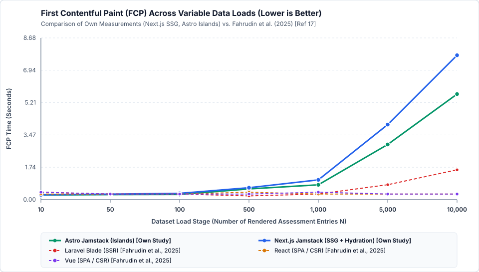
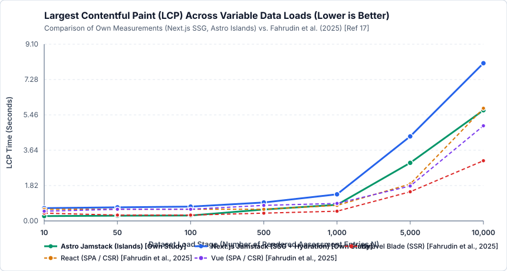
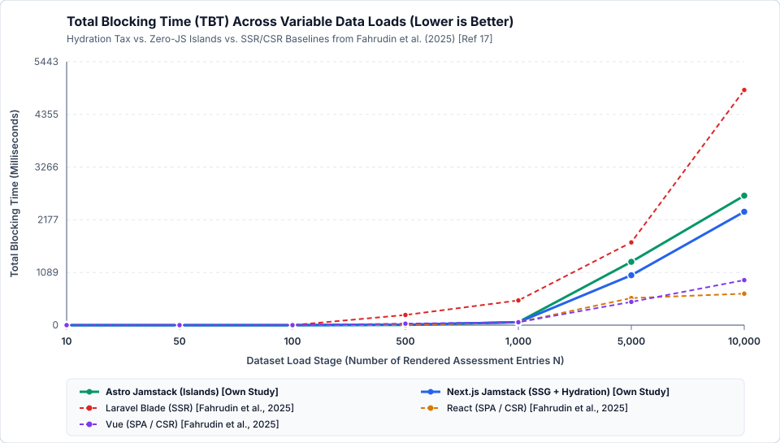
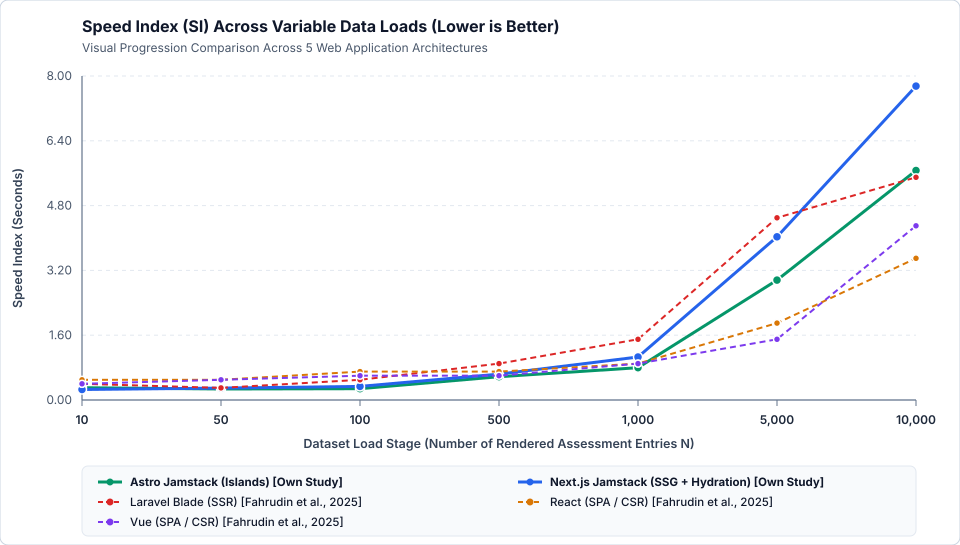

# Empirical Benchmark Report: Jamstack (Next.js SSG & Astro Islands) vs. SSR & CSR [Ref 17]

## 1. Benchmark Execution Environment (Scenario Metadata)
- **Timestamp:** `2026-11-10T17:47:06.976Z`
- **OS / Kernel:** `Linux 6.12.105+ (x64)`
- **CPU:** `Intel(R) Xeon(R) 6985P-C` (2 logical cores)
- **RAM:** `7.76 GB`
- **Node.js Runtime:** `v24.22.2`
- **Browser Engine:** `Chromium 156.0.8078.79 built on Debian GNU/Linux 12 (bookworm)`
- **Lighthouse Configuration:** Desktop Preset (`1350x940`, `formFactor: desktop`), **n = 5 repetitions** per stage and architecture
- **Primary Reference Baseline:** Fahrudin et al. (2025) [Ref 17] (*Laravel Blade SSR, React CSR, Vue CSR*)

---

## 2. Own Empirical Measurements: Detailed Summary Statistics ($\mu \pm \sigma$)

| Architecture | Data Load ($N$) | Perf. Score ($\mu \pm \sigma$) | FCP [s] ($\mu \pm \sigma$) | LCP [s] ($\mu \pm \sigma$) | TBT [ms] ($\mu \pm \sigma$) | Speed Index [s] ($\mu \pm \sigma$) | CLS ($\mu$) | HTML Size [kB] | JS Bundle [kB] | DOM Elements |
| :--- | ---: | ---: | ---: | ---: | ---: | ---: | ---: | ---: | ---: | ---: |
| **Astro (Jamstack SSG + Islands)** | 10 | **100.0** (±0.0) | 0.250 (±0.027) | 0.250 (±0.027) | 0.0 (±0.0) | 0.304 (±0.077) | 0.0000 | 17.0 | 0.0 | 265 |
| **Astro (Jamstack SSG + Islands)** | 50 | **100.0** (±0.0) | 0.271 (±0.001) | 0.271 (±0.001) | 0.0 (±0.0) | 0.271 (±0.001) | 0.0000 | 43.8 | 0.0 | 1,025 |
| **Astro (Jamstack SSG + Islands)** | 100 | **100.0** (±0.0) | 0.278 (±0.008) | 0.278 (±0.008) | 0.0 (±0.0) | 0.278 (±0.008) | 0.0000 | 77.9 | 0.0 | 1,975 |
| **Astro (Jamstack SSG + Islands)** | 500 | **100.0** (±0.0) | 0.575 (±0.051) | 0.589 (±0.038) | 2.9 (±4.1) | 0.575 (±0.051) | 0.0000 | 348.1 | 0.0 | 9,575 |
| **Astro (Jamstack SSG + Islands)** | 1,000 | **98.4** (±0.5) | 0.797 (±0.034) | 0.832 (±0.039) | 62.1 (±29.3) | 0.797 (±0.034) | 0.0000 | 685.3 | 0.0 | 19,075 |
| **Astro (Jamstack SSG + Islands)** | 5,000 | **37.8** (±0.4) | 2.961 (±0.027) | 2.990 (±0.042) | 1307.9 (±67.6) | 2.961 (±0.027) | 0.0000 | 3385.2 | 0.0 | 95,075 |
| **Astro (Jamstack SSG + Islands)** | 10,000 | **26.0** (±0.0) | 5.667 (±0.006) | 5.700 (±0.009) | 2675.5 (±102.6) | 5.667 (±0.006) | 0.0000 | 6760.2 | 0.0 | 190,075 |
| **Next.js (Jamstack SSG + Hydration)** | 10 | **100.0** (±0.0) | 0.259 (±0.002) | 0.658 (±0.004) | 0.0 (±0.0) | 0.259 (±0.002) | 0.0000 | 18.6 | 350.5 | 275 |
| **Next.js (Jamstack SSG + Hydration)** | 50 | **100.0** (±0.0) | 0.295 (±0.007) | 0.701 (±0.002) | 0.0 (±0.0) | 0.295 (±0.007) | 0.0000 | 55.8 | 350.5 | 1,035 |
| **Next.js (Jamstack SSG + Hydration)** | 100 | **100.0** (±0.0) | 0.337 (±0.008) | 0.736 (±0.006) | 0.0 (±0.0) | 0.337 (±0.008) | 0.0000 | 102.9 | 350.5 | 1,985 |
| **Next.js (Jamstack SSG + Hydration)** | 500 | **98.4** (±0.5) | 0.640 (±0.022) | 0.950 (±0.077) | 10.4 (±16.2) | 0.640 (±0.022) | 0.0000 | 476.7 | 350.5 | 9,585 |
| **Next.js (Jamstack SSG + Hydration)** | 1,000 | **94.0** (±0.7) | 1.061 (±0.064) | 1.371 (±0.060) | 60.0 (±34.9) | 1.061 (±0.064) | 0.0000 | 943.0 | 350.5 | 19,085 |
| **Next.js (Jamstack SSG + Hydration)** | 5,000 | **31.2** (±0.4) | 4.030 (±0.092) | 4.353 (±0.006) | 1030.7 (±134.7) | 4.030 (±0.092) | 0.0000 | 4676.4 | 350.5 | 95,085 |
| **Next.js (Jamstack SSG + Hydration)** | 10,000 | **25.0** (±0.0) | 7.751 (±0.014) | 8.121 (±0.005) | 2344.0 (±251.8) | 7.751 (±0.014) | 0.0000 | 9343.2 | 350.5 | 190,085 |

---

## 3. Cross-Study Comparison: Own Measurements vs. Fahrudin et al. (2025) [Ref 17]
*(Best values per data load stage are highlighted in **bold** in accordance with Lecture 04 – Documentation, Slide 51.)*

### 3.1 First Contentful Paint — FCP (in Seconds, Lower is Better)
| Data Load ($N$) | Astro Islands [Own, $\mu \pm \sigma$] | Next.js SSG [Own, $\mu \pm \sigma$] | Blade SSR [Ref 17] | React CSR [Ref 17] | Vue CSR [Ref 17] |
| ---: | :---: | :---: | :---: | :---: | :---: |
| **10** | **0.25s (±0.03)** | 0.26s (±0.00) | 0.40s | 0.30s | 0.40s |
| **50** | **0.27s (±0.00)** | 0.29s (±0.01) | 0.30s | 0.30s | 0.30s |
| **100** | **0.28s (±0.01)** | 0.34s (±0.01) | 0.30s | 0.30s | 0.30s |
| **500** | 0.57s (±0.05) | 0.64s (±0.02) | **0.20s** | 0.40s | 0.30s |
| **1,000** | 0.80s (±0.03) | 1.06s (±0.06) | **0.30s** | **0.30s** | 0.40s |
| **5,000** | 2.96s (±0.03) | 4.03s (±0.09) | 0.80s | **0.30s** | **0.30s** |
| **10,000** | 5.67s (±0.01) | 7.75s (±0.01) | 1.60s | **0.30s** | **0.30s** |

### 3.2 Largest Contentful Paint — LCP (in Seconds, Lower is Better)
| Data Load ($N$) | Astro Islands [Own, $\mu \pm \sigma$] | Next.js SSG [Own, $\mu \pm \sigma$] | Blade SSR [Ref 17] | React CSR [Ref 17] | Vue CSR [Ref 17] |
| ---: | :---: | :---: | :---: | :---: | :---: |
| **10** | **0.25s (±0.03)** | 0.66s (±0.00) | 0.40s | 0.60s | 0.50s |
| **50** | **0.27s (±0.00)** | 0.70s (±0.00) | 0.30s | 0.60s | 0.60s |
| **100** | **0.28s (±0.01)** | 0.74s (±0.01) | 0.30s | 0.60s | 0.60s |
| **500** | 0.59s (±0.04) | 0.95s (±0.08) | **0.40s** | 0.60s | 0.80s |
| **1,000** | 0.83s (±0.04) | 1.37s (±0.06) | **0.50s** | 0.80s | 0.90s |
| **5,000** | 2.99s (±0.04) | 4.35s (±0.01) | **1.50s** | 1.90s | 1.80s |
| **10,000** | 5.70s (±0.01) | 8.12s (±0.01) | **3.10s** | 5.80s | 4.90s |

### 3.3 Total Blocking Time — TBT (in Milliseconds, Lower is Better)
| Data Load ($N$) | Astro Islands [Own, $\mu \pm \sigma$] | Next.js SSG [Own, $\mu \pm \sigma$] | Blade SSR [Ref 17] | React CSR [Ref 17] | Vue CSR [Ref 17] |
| ---: | :---: | :---: | :---: | :---: | :---: |
| **10** | **0 ms (±0)** | **0 ms (±0)** | **0 ms** | **0 ms** | **0 ms** |
| **50** | **0 ms (±0)** | **0 ms (±0)** | **0 ms** | **0 ms** | **0 ms** |
| **100** | **0 ms (±0)** | **0 ms (±0)** | **0 ms** | **0 ms** | **0 ms** |
| **500** | 3 ms (±4) | 10 ms (±16) | 210 ms | **0 ms** | 30 ms |
| **1,000** | 62 ms (±29) | **60 ms (±35)** | 510 ms | **60 ms** | **60 ms** |
| **5,000** | 1308 ms (±68) | 1031 ms (±135) | 1710 ms | 560 ms | **480 ms** |
| **10,000** | 2676 ms (±103) | 2344 ms (±252) | 4860 ms | **650 ms** | 930 ms |

### 3.4 Speed Index — SI (in Seconds, Lower is Better)
| Data Load ($N$) | Astro Islands [Own, $\mu \pm \sigma$] | Next.js SSG [Own, $\mu \pm \sigma$] | Blade SSR [Ref 17] | React CSR [Ref 17] | Vue CSR [Ref 17] |
| ---: | :---: | :---: | :---: | :---: | :---: |
| **10** | 0.30s (±0.08) | **0.26s (±0.00)** | 0.40s | 0.50s | 0.40s |
| **50** | **0.27s (±0.00)** | 0.29s (±0.01) | 0.30s | 0.50s | 0.50s |
| **100** | **0.28s (±0.01)** | 0.34s (±0.01) | 0.50s | 0.70s | 0.60s |
| **500** | **0.57s (±0.05)** | 0.64s (±0.02) | 0.90s | 0.70s | 0.60s |
| **1,000** | **0.80s (±0.03)** | 1.06s (±0.06) | 1.50s | 0.90s | 0.90s |
| **5,000** | 2.96s (±0.03) | 4.03s (±0.09) | 4.50s | 1.90s | **1.50s** |
| **10,000** | 5.67s (±0.01) | 7.75s (±0.01) | 5.50s | **3.50s** | 4.30s |

---

## 4. Visualized Performance Curves (Zero-Baseline Axes)
- 
- 
- 
- 
